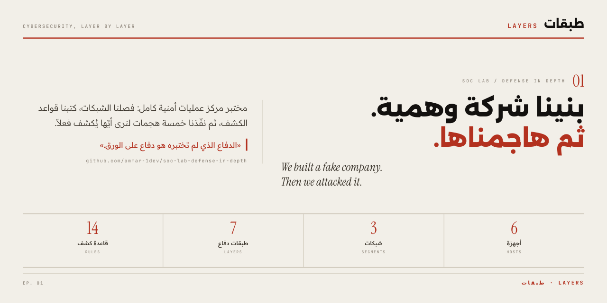
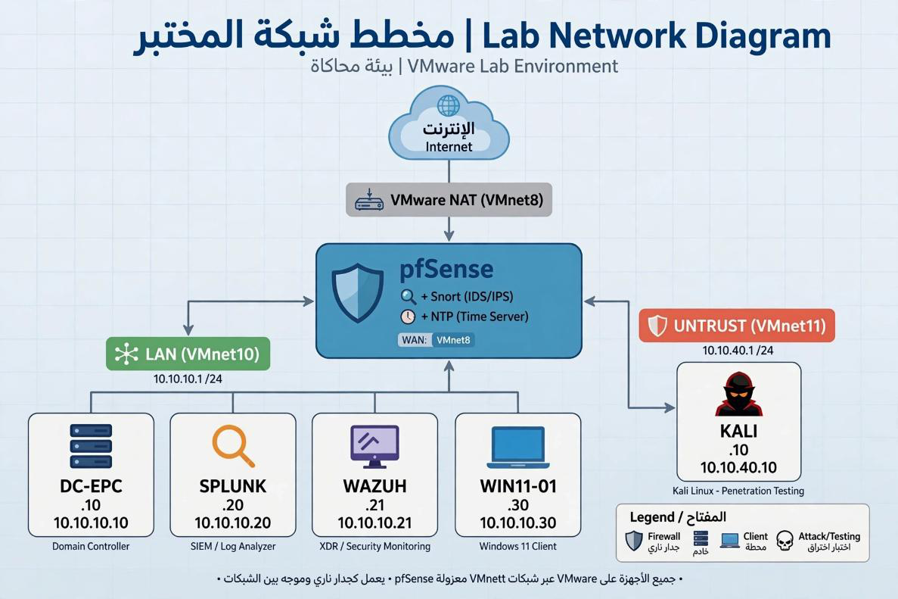
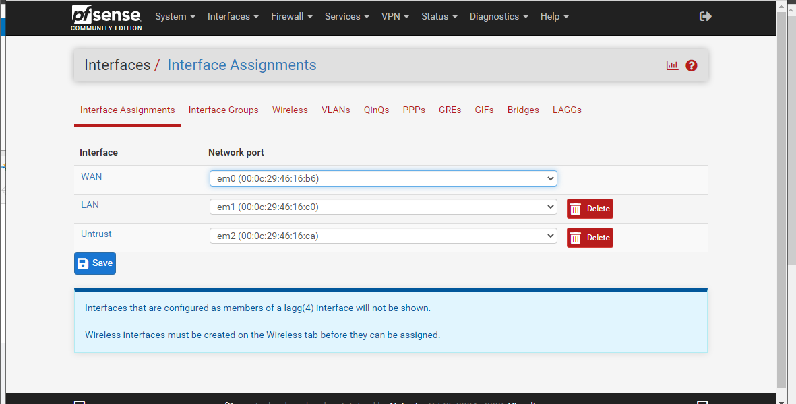
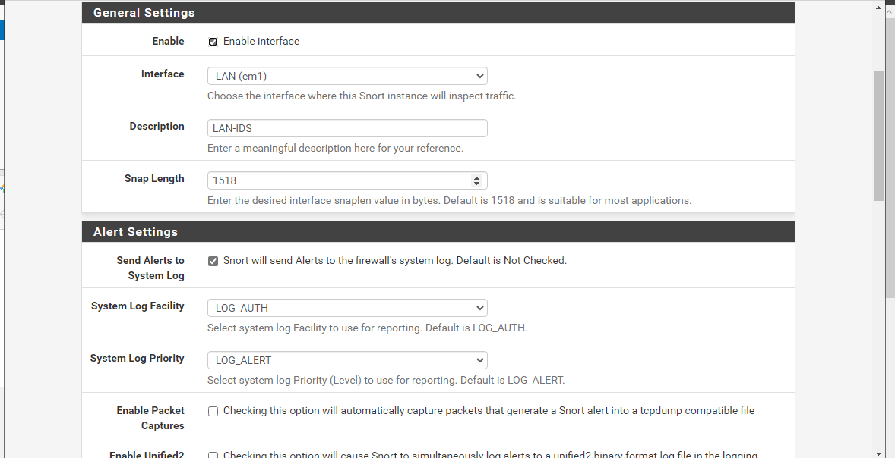
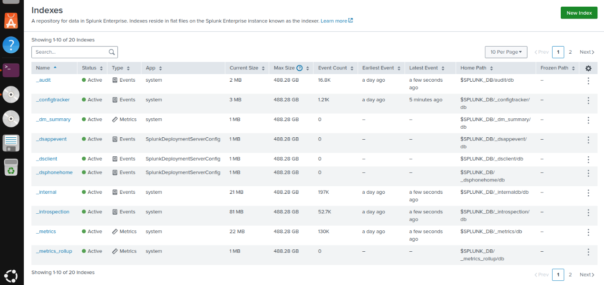

<div align="center">



# مختبر مركز عمليات أمنية — الدفاع متعدد الطبقات

### تصميم وتنفيذ والتحقق من مركز عمليات أمنية متعدد الطبقات

**طبقات · LAYERS — الحلقة 01**


</div>

---

## بطاقة الوثيقة

| الحقل | القيمة |
|:---|:---|
| **معرّف الوثيقة** | `LAYERS-SOC-001` |
| **نوع الوثيقة** | تقرير تصميم وتحقق فني |
| **الإصدار** | 2.0 |
| **الحالة** | صادرة |
| **تاريخ الإصدار** | 2026-11-06 |
| **التصنيف** | عام — بيئة مختبرية فقط |
| **يحل محل** | الإصدار 1.0 (الملخص المختصر) |
| **الترخيص** | MIT |

> **سياسة اللغة:** واجهة المستودع وسياساته بالعربية. الوثائق التقنية التفصيلية في مجلد `docs/` بالإنجليزية وفق صياغة المواصفات الدولية، لتبقى قابلة للاستشهاد والمراجعة من أي جهة.

---

## 1. الملخص

يوثّق هذا المستودع تصميم وتنفيذ والتحقق من مختبر مركز عمليات أمنية (SOC) داخل بيئة افتراضية معزولة بالكامل. يحاكي المختبر شبكة مؤسسة صغيرة تتكوّن من **ستة أجهزة افتراضية** موزّعة على **ثلاث شبكات مفصولة**، محمية بـ **سبع طبقات دفاع متتالية**، ومزوّدة بـ **أربع عشرة قاعدة كشف شبكي** كُتبت خصيصاً لهذا الغرض.

اختُبرت منظومة الضوابط مقابل **خمسة سيناريوهات هجوم موثّقة** نُفّذت من شبكة مهاجم مخصّصة وبتصريح صريح. كُشفت السيناريوهات الخمسة جميعاً، وأنتجت القياسات عن بُعد **أكثر من عشرين نوع تنبيه مميّز**. ورُبطت النتائج بقاعدة معرفة MITRE ATT&CK Enterprise، وأُجريت مطابقة مرجعية مع ISO/IEC 27001:2022 و PCI DSS v4.0 و CIS Controls v8.1.

**الخلاصة الهندسية الأساسية:** قدرة الكشف خاصية **تكامل** لا خاصية أدوات. فالفحص المحيطي وحوكمة الهوية والتحكّم في الجهاز والتحليل المركزي يرى كل منها صورة جزئية، ولا تكتمل الصورة القابلة للتنفيذ إلا بربطها معاً.

---

## 2. النطاق

### 2.1 داخل النطاق

- تصميم معمارية الشبكة وفصل الشبكات
- الضوابط الوقائية والكشفية والاستجابية متعددة الطبقات
- هندسة قواعد الكشف الشبكي المخصّصة
- الجمع المركزي للسجلات والربط بينها
- محاكاة المهاجم المصرّح بها والتحقق من الكشف
- المطابقة المرجعية مع أطر الضوابط

### 2.2 خارج النطاق

- النشر الإنتاجي وهندسة التوافرية (Availability) والتخطيط للسعة
- إنتاج استخبارات التهديدات ونسب الهجمات
- الهندسة العكسية للبرمجيات الخبيثة
- تقييم أي نظام تابع لجهة أخرى أو أي نظام عام

### 2.3 بيان التصريح

نُفّذت كل الأنشطة الهجومية الموصوفة هنا **حصراً داخل بيئة مختبرية معزولة من نوع host-only يملكها فريق المشروع**، وعلى أنظمة أُنشئت لهذا الغرض. لم يكن أي نظام إنتاجي أو أصل تابع لجهة أخرى أو نطاق عناوين عام أو بيانات طرف ثالث جزءاً من العمل في أي مرحلة.

---

## 3. بنية المستودع

```
.
├── README.md                          نظرة عامة ونتائج (هذه الوثيقة — عربي)
├── SECURITY.md                        سياسة الإفصاح وشروط السلامة المختبرية (عربي)
├── CONTRIBUTING.md                    إجراءات المساهمة والمراجعة (عربي)
├── CHANGELOG.md                       تاريخ المراجعات (عربي)
├── CITATION.cff                       بيانات الاستشهاد (إنجليزي — صيغة معيارية)
├── LICENSE                            ترخيص MIT
├── docs/                              الوثائق التقنية — إنجليزي
│   ├── 00-document-control.md         سجل الوثائق وتاريخ المراجعات
│   ├── 01-architecture.md             معمارية الشبكة والأجهزة
│   ├── 02-defense-layers.md           تصميم الضوابط — الطبقات 1 إلى 7
│   ├── 03-detection-engineering.md    كتالوج القواعد وخط السجلات
│   ├── 04-validation-and-results.md   خطة الاختبار والنتائج ومطابقة ATT&CK
│   ├── 05-control-framework-mapping.md مطابقة ISO / PCI DSS / CIS
│   ├── 06-operations-runbook.md       إجراءات الفرز والاستجابة
│   ├── 07-limitations-and-roadmap.md  القيود المعلنة وخطة العمل
│   ├── 08-glossary.md                 المصطلحات والاختصارات
│   ├── 09-references.md               المراجع المعيارية والإرشادية
│   ├── network-diagram.png            الشكل 1 — مخطط المختبر
│   ├── social-preview.png             صورة غلاف المستودع
│   └── screenshots/                   الأشكال 2 إلى 4 — أدلة التنفيذ
└── rules/
    └── README.md                      سجل القواعد (إنجليزي) — SID 1000001–1000014
```

---

## 4. ملخص المعمارية

يعمل المختبر على hypervisor واحد من نوع VMware، ومقسّم إلى ثلاث مناطق ثقة. يعبر الترافيك بين المناطق جدار الحماية بحكم التصميم، ولا يوجد مسار تجاوز.

| المنطقة | العنونة | نوع الشبكة | الوظيفة |
|:---|:---|:---|:---|
| `WAN` | عناوين NAT | NAT | عبور خارجي محاكى |
| `LAN` | `10.10.10.0/24` | Host-only | منطقة المؤسسة: الدليل، التحليلات، الجهاز |
| `UNTRUST` | `10.10.40.0/24` | Host-only | منطقة المهاجم المعزولة |

<div align="center">

<br>
<sub><b>الشكل 1.</b> مخطط شبكة المختبر وحدود مناطق الثقة.</sub>
</div>

تعمل خدمات الدليل تحت نطاق المختبر المحجوز `corp.test`. جرد الأجهزة الكامل وتعيين الواجهات موصوفان في [`docs/01-architecture.md`](docs/01-architecture.md).

---

## 5. طبقات الدفاع

| الطبقة | المجال | القدرة المنفّذة |
|:---:|:---|:---|
| 1 | المحيط · Perimeter | تطبيق سياسات pfSense مع فحص Snort المباشر |
| 2 | الهوية · Identity | Active Directory Domain Services مع سبع سياسات مجموعة (GPO) |
| 3 | الجهاز · Endpoint | التحكّم في التطبيقات، تقييد الوسائط القابلة للإزالة، قياسات Sysmon |
| 4 | الإدارة · Management | إدارة مركزية للأجهزة وتنسيق التحديثات |
| 5 | التدقيق · Audit | تدقيق تغييرات الدليل ومراقبة المجموعات ذات الصلاحيات |
| 6 | الرؤية · Visibility | ربط Splunk Enterprise وكشف Wazuh على مستوى الجهاز |
| 7 | الاستجابة · Response | حجب آلي للعناوين واحتواء مدفوع بالسياسات |

أهداف الضوابط ومبررات الإعداد والمخاطر المتبقية موثّقة لكل طبقة في [`docs/02-defense-layers.md`](docs/02-defense-layers.md).

---

## 6. تغطية الكشف

تُكمِل **أربع عشرة قاعدة مخصّصة** (`SID 1000001`–`1000014`) حزم القواعد العامة المشتركة. ويُستمد الكشف على مستوى الجهاز من قنوات أحداث Windows Security و Sysmon ومن قياسات وكلاء Wazuh.

| معرّف الحدث | القناة | غرض الكشف |
|:---|:---|:---|
| `4625` | Windows Security | فشل تسجيل دخول — تخمين بيانات اعتماد |
| `4663` | Windows Security | محاولة وصول إلى كائن — كتابة على وسيط قابل للإزالة |
| `8004` | AppLocker | محاولة تنفيذ تطبيق مقيّد |
| `4728` | Windows Security | إضافة عضو إلى مجموعة أمنية عامة |

سجل القواعد الكامل في [`rules/README.md`](rules/README.md)، وخط السجلات وتصميم الفهارس موصوفان في [`docs/03-detection-engineering.md`](docs/03-detection-engineering.md).

---

## 7. نتائج التحقق

نُفّذت خمسة سيناريوهات من منطقة `UNTRUST`. كان لكل سيناريو أثر كشفي متوقّع **مُعلن قبل التنفيذ**، وسُجّلت النتائج مقابل هذا التوقّع.

| # | السيناريو | تقنية ATT&CK | نتيجة الكشف |
|:---:|:---|:---|:---|
| 1 | استكشاف الخدمات بـ TCP SYN | [T1046](https://attack.mitre.org/techniques/T1046/) | كُشف — تنبيه Snort مربوط في Splunk |
| 2 | تخمين بيانات اعتماد RDP | [T1110.001](https://attack.mitre.org/techniques/T1110/001/) | كُشف — قاعدة Snort، الحدث `4625`، تنبيه تدقيق الدليل |
| 3 | محاولة تسريب عبر وسيط قابل للإزالة | [T1052.001](https://attack.mitre.org/techniques/T1052/001/) | مُنع وسُجّل — حجب بالسياسة، الحدث `4663` |
| 4 | تنفيذ تطبيق غير مصرّح به | [T1204.002](https://attack.mitre.org/techniques/T1204/002/) | مُنع وسُجّل — AppLocker، الحدث `8004`، تنبيه Wazuh |
| 5 | تصعيد صلاحيات عبر عضوية مجموعة | [T1098](https://attack.mitre.org/techniques/T1098/) | كُشف — الحدث `4728`، تنبيه حرج من تدقيق الدليل |

**النتيجة:** 5 من 5 سيناريوهات أنتجت الأثر الكشفي المتوقّع، ولوحظ أكثر من عشرين نوع تنبيه مميّز خلال دورة التحقق.

ظروف الاختبار ومعايير القبول والأدلة لكل سيناريو مسجّلة في [`docs/04-validation-and-results.md`](docs/04-validation-and-results.md).

---

## 8. أدلة التنفيذ

<div align="center">

<br>
<sub><b>الشكل 2.</b> تعيين واجهات جدار الحماية الذي يُنشئ مناطق الثقة الثلاث.</sub>
<br><br>

<br>
<sub><b>الشكل 3.</b> إعداد واجهة Snort وتحويل التنبيهات إلى المجمّع المركزي.</sub>
<br><br>

<br>
<sub><b>الشكل 4.</b> شاشة إدارة الفهارس في Splunk Enterprise. تُظهر اللقطة الصفحة الأولى من قائمة الفهارس، وتظهر الفهارس المبنية خصيصاً في الصفحة التالية.</sub>
</div>

---

## 9. أهم النتائج

1. **التكامل هو ما يحدّد قدرة الكشف.** الفحص المحيطي لا يرى النشاط الأفقي داخل الأجهزة، و SIEM لا يطبّق سياسة، ومراقبة الجهاز لا تفهم قصد الشبكة. الربط بين الثلاثة هو الضابط الفعلي.
2. **الضابط غير المُختبَر ضابط غير مُتحقَّق منه.** ظهرت فجوتان في الضوابط فقط لأن الفريق نفّذ نشاطاً هجومياً على تصميمه بنفسه. مراجعة الإعدادات وحدها لم تكن لتكشفهما.
3. **المنع والكشف مكمّلان لا بديلان.** السيناريوهان 3 و 4 مُنعا بالسياسة، ومع ذلك بقي سجل التدقيق ضرورياً لتحديد حجم المحاولة.
4. **محاكاة المهاجم المصرّح بها نشاط تصميمي.** إعلان التوقّعات الكشفية قبل التنفيذ حوّل التمرين من استعراض إلى قياس.

---

## 10. القيود

يوثّق هذا المستودع تنفيذاً مختبرياً، وهو **ليس** معمارية مرجعية للإنتاج. القيود المعروفة — تركّز كل المناطق على hypervisor واحد، غياب فحص الترافيك المشفّر، قِصر مدة خط الأساس، وتعليق نشر ملف القواعد الخام — مذكورة صراحة في [`docs/07-limitations-and-roadmap.md`](docs/07-limitations-and-roadmap.md).

---

## 11. النسب

نُفّذ المشروع بواسطة **فريق هندسي من أربعة أعضاء** تحت إشراف أكاديمي، ويُنشر كجزء من سلسلة **طبقات · LAYERS** التقنية، الحلقة 01.

الأسماء الفردية محجوبة في هذه النسخة العامة. ولا تنطبق هنا مسألة هوية عميل أو جهة، إذ لم تكن أي جهة تجارية طرفاً في العمل.

---

## 12. الترخيص

صادر تحت ترخيص MIT. انظر [`LICENSE`](LICENSE).

تحتفظ حزم القواعد العامة المشتركة بتراخيصها الخاصة (Cisco Talos VRT، قواعد المجتمع GPLv2، Emerging Threats Open). ولا يُعاد توزيع أي محتوى من هذه الحزم في هذا المستودع.

---

<div align="center">

<sub>طبقات · LAYERS — الأمن السيبراني، طبقة بطبقة · الحلقة 01</sub>

</div>
