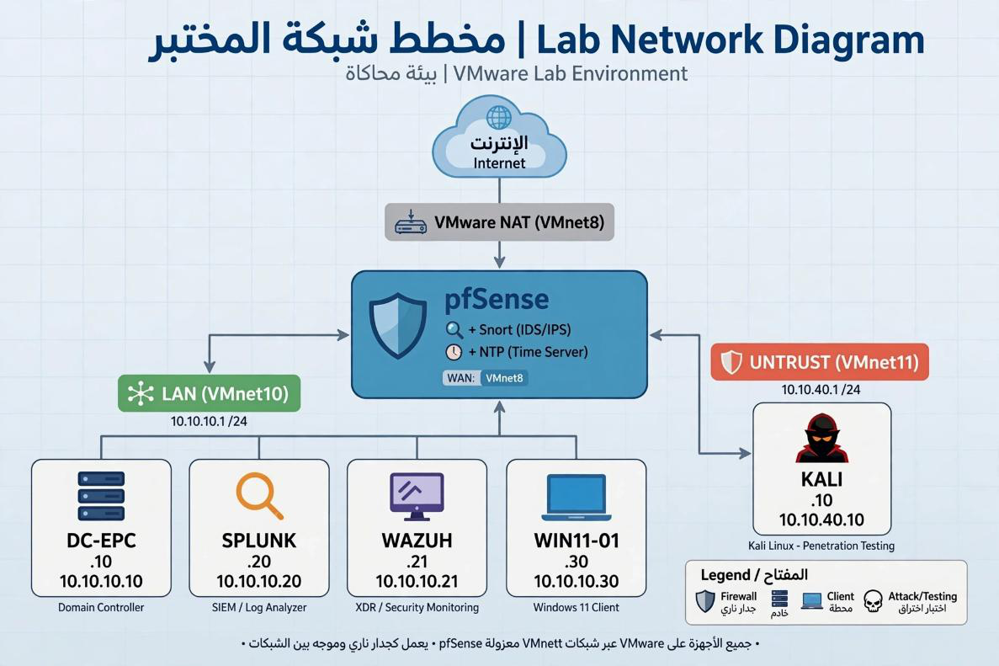
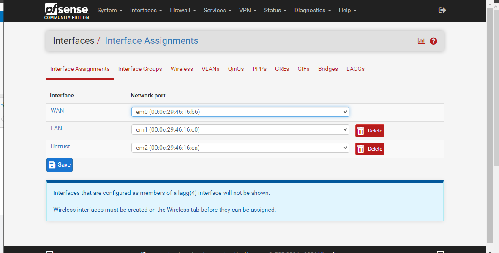

# Network and Host Architecture

| Field | Value |
|:---|:---|
| **Document identifier** | `LAYERS-SOC-002` |
| **Version** | 2.0 |
| **Status** | Released |
| **Date of issue** | 2026-11-06 |
| **Classification** | Public — laboratory environment only |

---

## 1. Objective

This document specifies the physical and logical architecture of the laboratory: the virtualisation platform, the trust-zone model, the host inventory, interface assignments and the addressing plan.

---

## 2. Design Requirements

| Ref | Requirement |
|:---|:---|
| `AR-01` | The environment **shall** be incapable of reaching, or being reached from, any production or third-party network. |
| `AR-02` | Adversary activity **shall** originate from a segment that is logically separated from the corporate segment. |
| `AR-03` | All inter-segment traffic **shall** traverse the perimeter firewall; no direct host-only bridge between `LAN` and `UNTRUST` shall exist. |
| `AR-04` | Security telemetry **shall** be forwarded to a central collector rather than retained solely on the originating host. |
| `AR-05` | The directory domain **shall** use a reserved, non-resolvable namespace. |
| `AR-06` | Management interfaces of security tooling **should** be reachable only from the corporate segment. |

---

## 3. Platform

The environment is realised on a single VMware hypervisor. Six virtual machines are provisioned. Three virtual networks are defined: one NAT network providing simulated external transit, and two host-only networks providing the corporate and adversary segments.

---

## 4. Trust Zones

| Zone | Subnet | Network type | Trust level | Contents |
|:---|:---|:---|:---|:---|
| `WAN` | NAT-assigned | NAT | Untrusted transit | Firewall external interface |
| `LAN` | `10.10.10.0/24` | Host-only | Managed | Directory server, SIEM, HIDS manager, user endpoint |
| `UNTRUST` | `10.10.40.0/24` | Host-only | Adversarial | Attack platform |

### 4.1 Segmentation rationale

Placing the adversary platform on a separate host-only network — rather than on the NAT network — satisfies `AR-01` and `AR-03` simultaneously: the attack platform has no route to the Internet, and every packet it sends toward the corporate segment must cross the firewall, where it is subject to policy and inspection.

---

## 5. Host Inventory

| Ref | Host role | Platform | Zone | Function |
|:---:|:---|:---|:---|:---|
| `H-01` | Perimeter firewall and IDS | pfSense with Snort | `WAN` + `LAN` + `UNTRUST` | Routing, policy enforcement, inline network inspection |
| `H-02` | Directory server | Windows Server, AD DS | `LAN` | Authentication, DNS, Group Policy, directory audit source |
| `H-03` | SIEM | Splunk Enterprise on Ubuntu 22.04 | `LAN` | Log ingestion, indexing, correlation, dashboards |
| `H-04` | HIDS manager | Wazuh manager and dashboard | `LAN` | Agent management, host-based detection, active response |
| `H-05` | User endpoint | Windows 11, domain-joined | `LAN` | Control target and endpoint telemetry source |
| `H-06` | Adversary platform | Kali Linux | `UNTRUST` | Authorised attack emulation |

### 5.1 Directory namespace

The Active Directory domain is `corp.test`. The `.test` top-level domain is reserved for testing and does not resolve publicly, satisfying `AR-05`.

---

## 6. Topology

 
<b>Figure 1.</b> Trust zones, host placement and inspection points.

### 6.1 Traffic paths

| Path | Traversal | Inspection applied |
|:---|:---|:---|
| `UNTRUST` → `LAN` | Firewall | Firewall policy, Snort signatures |
| `LAN` → `WAN` | Firewall | Firewall policy, Snort signatures |
| `LAN` → `LAN` (east–west) | Switched, same segment | Host-based controls, Sysmon, Wazuh agents |
| `LAN` → collector | Switched, same segment | Not inspected; management traffic restricted by policy |

The east–west path is the principal reason host-based telemetry is required: perimeter inspection does not observe it. This is the architectural basis of the finding recorded in the overview, §9.1.

---

## 7. Interface Evidence

 
<b>Figure 2.</b> Firewall interface assignments. Three interfaces are bound to the three virtual networks, establishing the zone boundary.

---

## 8. Telemetry Flows

| Flow | Source | Destination | Transport |
|:---|:---|:---|:---|
| Network alerts | Snort on `H-01` | `H-03` | Syslog, UDP `5514` |
| Windows event channels | `H-02`, `H-05` | `H-03` | Universal Forwarder, TCP `9997` |
| Endpoint telemetry | Wazuh agents on `H-02`, `H-05` | `H-04` | Agent channel |
| Analyst access | Analyst workstation in `LAN` | `H-03` | HTTPS, TCP `8000` |

Two Wazuh agents are deployed. Forwarder and collector configuration is specified in `03-detection-engineering.md`, §4.

---

## 9. Residual Architectural Risks

| Ref | Risk | Consequence | Treatment |
|:---|:---|:---|:---|
| `RR-01` | Single hypervisor hosts all zones | A hypervisor compromise defeats segmentation | Accepted for a laboratory; unacceptable in production |
| `RR-02` | Collector and directory share one segment | A compromised endpoint is adjacent to the log store | Management-plane access restriction; dedicated management zone recommended |
| `RR-03` | No time-source hierarchy documented | Correlation accuracy depends on consistent timestamps | Clock synchronisation should be formalised (CIS Safeguard 8.4) |
| `RR-04` | No encrypted-traffic inspection | Payload-based signatures do not apply to TLS sessions | Metadata-based detection; see `07-limitations-and-roadmap.md` |

---

## 10. Conformance Summary

| Requirement | Status | Basis |
|:---|:---:|:---|
| `AR-01` | Met | Both internal segments are host-only |
| `AR-02` | Met | Adversary platform confined to `UNTRUST` |
| `AR-03` | Met | Firewall is the sole inter-segment path (Figure 2) |
| `AR-04` | Met | Syslog and forwarder flows to `H-03` |
| `AR-05` | Met | Reserved `.test` namespace |
| `AR-06` | Partially met | Signature coverage for non-management access is defined; enforcement evidence pending |

---

[← Document control](00-document-control.md) · [Back to overview →](../README.md)
