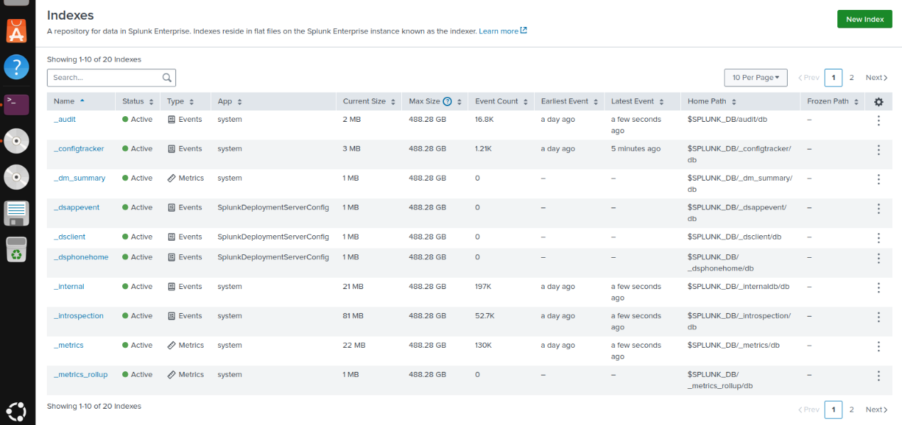

# Detection Engineering and Log Pipeline

| Field | Value |
|:---|:---|
| **Document identifier** | `LAYERS-SOC-004` |
| **Version** | 2.0 |
| **Status** | Released |
| **Date of issue** | 2026-11-06 |
| **Classification** | Public — laboratory environment only |

---

## 1. Objective

This document specifies the detection logic of the laboratory: the network signature catalogue, the host event sources, the log transport and index design, and the engineering rules applied when authoring a signature.

---

## 2. Detection Sources

| Source | Type | Coverage |
|:---|:---|:---|
| Snort on the perimeter firewall | Network signature | Traffic crossing a zone boundary |
| Subscribed public rulesets | Network signature | Known-malicious patterns at scale |
| Windows Security channel | Host audit | Authentication, object access, group change |
| AppLocker channel | Host application control | Execution attempts outside the approved set |
| Sysmon | Host instrumentation | Process creation, network connections, image loads |
| Wazuh agents | Host detection | File integrity, rootcheck, log-based rules |

Two Wazuh agents are deployed within the corporate segment.

---

## 3. Custom Network Signatures

Fourteen custom signatures were authored, occupying the private SID range `1000001`–`1000014`. The private range is used to avoid collision with subscribed rulesets.

| SID | Detection intent | ATT&CK mapping |
|:---:|:---|:---|
| `1000001` | ICMP echo reconnaissance from the adversary zone | [T1046](https://attack.mitre.org/techniques/T1046/) |
| `1000002` | TCP SYN service discovery | [T1046](https://attack.mitre.org/techniques/T1046/) |
| `1000003` | TCP XMAS flag-pattern scan | [T1046](https://attack.mitre.org/techniques/T1046/) |
| `1000004` | TCP NULL flag-pattern scan | [T1046](https://attack.mitre.org/techniques/T1046/) |
| `1000005` | RDP credential guessing | [T1110.001](https://attack.mitre.org/techniques/T1110/001/) |
| `1000006` | SMB access attempt from the adversary zone | [T1021.002](https://attack.mitre.org/techniques/T1021/002/) |
| `1000007` | SSH credential guessing | [T1110.001](https://attack.mitre.org/techniques/T1110/001/) |
| `1000008` | Anti-malware test artefact in transit | Control validation — not an adversary technique |
| `1000009` | DNS behaviour consistent with command-and-control | [T1071.004](https://attack.mitre.org/techniques/T1071/004/) |
| `1000010` | Outbound transfer consistent with exfiltration | [T1048](https://attack.mitre.org/techniques/T1048/) |
| `1000011` | SIEM interface access from a non-management source | [T1562.001](https://attack.mitre.org/techniques/T1562/001/) |
| `1000012` | HIDS interface access from a non-management source | [T1562.001](https://attack.mitre.org/techniques/T1562/001/) |
| `1000013` | Telnet session establishment — cleartext protocol | [T1040](https://attack.mitre.org/techniques/T1040/) |
| `1000014` | FTP session establishment — cleartext protocol | [T1040](https://attack.mitre.org/techniques/T1040/) |

The authoritative register, including severity assignment and publication status, is maintained in [`../rules/README.md`](../rules/README.md).

### 3.1 Signature authoring rules

| Ref | Rule |
|:---|:---|
| `DE-01` | Every custom signature **shall** use a SID within `1000001`–`1999999`. |
| `DE-02` | Address fields **shall** reference the variables `$HOME_NET` and `$EXTERNAL_NET` rather than literal addresses. |
| `DE-03` | Every signature **shall** carry a message, a reference and a severity classification. |
| `DE-04` | Threshold or rate limiting **should** be applied to any signature that can be triggered by normal administrative activity. |
| `DE-05` | A signature **shall not** be enabled for automated blocking until its false-positive behaviour has been observed against baseline traffic. |
| `DE-06` | Every signature **shall** declare an expected artefact before it is exercised in validation. |

`DE-02` also makes the signature set portable: the same rules can be loaded into another laboratory without editing addresses.

---

## 4. Log Transport

| Flow | Source | Collector | Port | Protocol |
|:---|:---|:---|:---:|:---|
| Network alerts | Snort | Splunk | `5514` | UDP (syslog) |
| Windows events | Universal Forwarder | Splunk indexer | `9997` | TCP |
| Analyst interface | Browser | Splunk Web | `8000` | HTTPS |
| Agent telemetry | Wazuh agents | Wazuh manager | Agent channel | Encrypted |

### 4.1 Transport requirements

| Ref | Requirement |
|:---|:---|
| `LT-01` | Forwarders **shall** be configured with the indexer as an explicit output; local-only retention is not acceptable. |
| `LT-02` | Forwarder health **should** be monitored; a silent forwarder failure produces false assurance. |
| `LT-03` | All sources **shall** synchronise time to a common reference before correlation is relied upon. |
| `LT-04` | Collector management interfaces **shall** be reachable only from the corporate segment. |

`LT-03` corresponds to CIS Safeguard 8.4 and is recorded as an open item in `07-limitations-and-roadmap.md`.

---

## 5. Index Design

Five purpose-built indexes are defined in addition to the platform defaults. Separation is by source class rather than by host, which keeps retention and access policy uniform within a class.

| Index class | Contents | Rationale for separation |
|:---|:---|:---|
| Network detection | Snort alerts forwarded from the firewall | High volume, short investigative half-life |
| Windows security | Authentication, object access, group change | Primary source for identity investigations |
| Endpoint instrumentation | Sysmon process and network telemetry | Highest volume; requires independent retention sizing |
| Host detection | Wazuh alerts and file-integrity events | Pre-scored detections, queried differently from raw events |
| Directory audit | Directory change audit records | Low volume, high value, long retention |

 
<b>Figure 4.</b> Index management view, first page. The platform default indexes are shown; the purpose-built indexes appear on the following page of the list.

> **Evidence note.** Figure 4 documents the index management interface. It does not, on its own, evidence the five purpose-built indexes. A capture of the second page is listed as a pending artefact.

---

## 6. Host Event Coverage

| Event ID | Channel | Semantics | Detection use |
|:---:|:---|:---|:---|
| `4625` | Security | An account failed to log on | Repeated failures against one target indicate credential guessing |
| `4663` | Security | An attempt was made to access an object | Access to removable storage under a restrictive policy |
| `8004` | AppLocker | A file was prevented from running | Execution attempt outside the approved application set |
| `4728` | Security | A member was added to a security-enabled global group | Privileged-group modification |

### 6.1 Correlation patterns

| Pattern | Sources joined | Interpretation |
|:---|:---|:---|
| Network signature + authentication failures | Snort `1000005` + `4625` | Confirms that a network-level guess reached the target and failed |
| Policy denial + object access | AppLocker `8004` + Wazuh alert | Confirms prevention and records the attempt for scoping |
| Group change + directory audit | `4728` + directory audit alert | Confirms the change and identifies the initiating account |
| Removable-media denial + object access | Group Policy + `4663` | Confirms the block and identifies the file targeted |

These four patterns are the concrete expression of the integration principle: no single source establishes both the attempt and its outcome.

---

## 7. Alert Volume

More than twenty distinct alert classes were observed across the validation run. Alert classes are counted by distinct detection logic, not by event volume, so the figure is not inflated by repeated triggering of one signature.

---

## 8. Known Detection Gaps

| Ref | Gap | Consequence |
|:---|:---|:---|
| `DG-01` | No TLS payload inspection | Signature logic does not apply to encrypted sessions |
| `DG-02` | No behavioural baseline of sufficient duration | Low-and-slow activity may not deviate detectably |
| `DG-03` | Address-based automated blocking | Ineffective against a rotating source |
| `DG-04` | Allow-listing does not cover in-memory execution | Requires memory-oriented telemetry |

These gaps are carried into the limitations register and are not presented as mitigated.

---

[← Defence layers](02-defense-layers.md) · [Validation and results →](04-validation-and-results.md)
